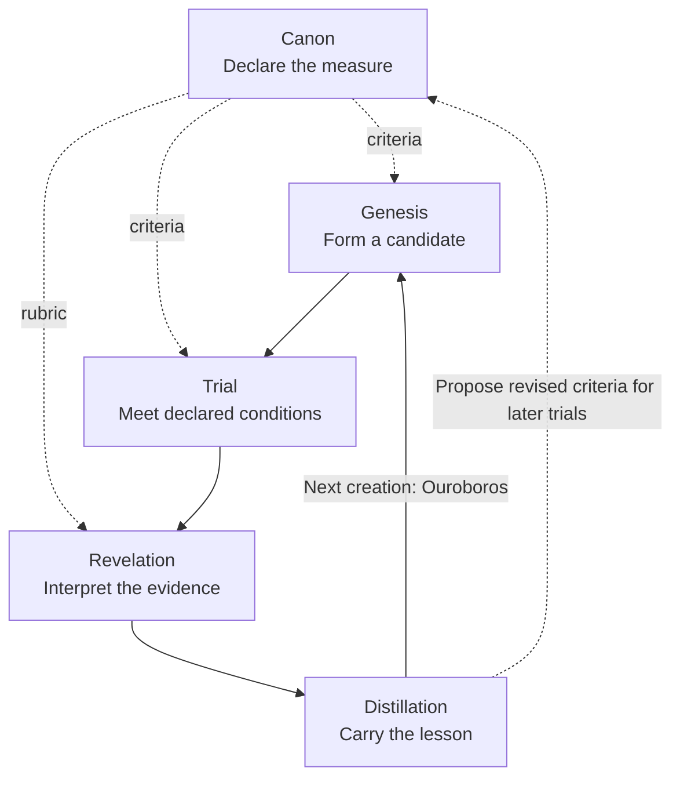

# :material-autorenew: Transmutation

A purpose acquires form, the form meets a world it cannot dictate, and the encounter changes
what can be made next. **Transmutation** follows that passage through a particular undertaking.
**Ouroboros** names its return: consequence becomes a distinction carried into another act of
creation.

These chapters can accompany ordinary development and review. Begin with an idea taking shape
in Genesis, follow what happens when it is tried, and ask what the next attempt should inherit.
[Transcendence](../transcendence/index.md) opens the wider horizon of the Great Work.

## Five chapters of the return

| Chapter | Question | What it carries |
| --- | --- | --- |
| [Genesis](genesis.md) | What shall we bring into existence? | Purpose, explored alternatives, and an attributable candidate. |
| [Trial](trial.md) | What happens when the candidate meets declared conditions? | Experiments, observations, and their limits. |
| [Canon](canon.md) | By what measure can we judge it? | Criteria, constraints, and the evidence needed for a verdict. |
| [Revelation](revelation.md) | What did the encounter disclose? | Findings, uncertainty, diagnoses, and proposed corrections. |
| [Distillation](distillation.md) | What should the next creation inherit? | A lesson with its conditions, source, and a proposed next use. |

This is a reading order. **Canon supplies the criteria before creation and testing.** The reader
returns to examine that measure after Trial; the work cannot choose its definition of success
after seeing the result.

The arrows follow meaning and evidence between separately admitted acts.
[Weaver's Ouroboros](../../sepulcher/extensions/weaver/ouroboros.md#why-the-whole-is-not-one-dag)
explains how a recurring method differs from its execution: this cycle is no single executable
DAG or hidden coordinator.

The names carry a literary thread through the
[Pentateuch](https://bible.usccb.org/bible/thepentateuch/0): beginnings, departure, ordered
practice, an accounting of the journey, and remembrance before a new undertaking. Each chapter
acknowledges its source. The engineering correspondence is the Hexanomicon's composition.

## Tree of Life

What does a possibility need from understanding? When should persistence receive support, and
when should it yield? The Tree makes these relations visible throughout the cycle.
[Genesis](genesis.md#tree-of-life) develops its ten sefirot, pillars, Adam Kadmon, and the
question of symmetry. The author's whiteboard workflow preceded this comparison; the Tree
deepens that design by revealing what one contribution asks of another.

The five chapters follow an undertaking through those relations. They are neither five sefirot
nor a fixed roster of Agents. A capacity introduced in Genesis may be needed again wherever
the work encounters a new question.

## From meaning to method

To put this movement into software work, enter
[Weaver's Creation](../../sepulcher/extensions/weaver/creation.md).
[SDLC](../../adr/16-sdlc.md#the-agentic-graph-of-creation) governs the passage from candidate
through verification to an owned effect. [Drift](../../sepulcher/extensions/drift/workflow-improvement.md)
asks what the evidence supports: it can examine a candidate, its manifested consequences, or
the method across tasks. Its [two scales of evaluation](../../sepulcher/extensions/drift/workflow-improvement.md#evaluate-at-two-scales)
keep those questions distinct.

A lesson may improve the next question or procedure. Where it instead identifies a transferable
skill gap, [Soulforge](../../sepulcher/extensions/soulforge/discernment-training.md) receives a
separately justified training hypothesis. These autonomous operating designs remain subject to
the delivery boundaries in [State of Work](../../state-of-the-work.md).
